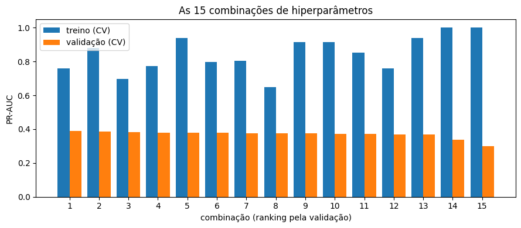
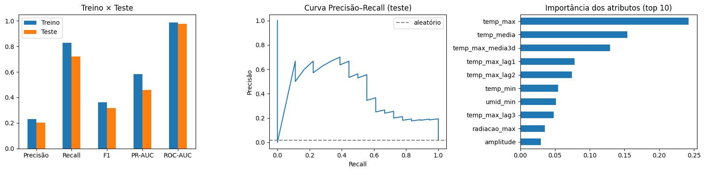

# RELATORIO_ML — CitizenTech: alerta de calor extremo em São Paulo

**Grupo:** Guilherme Linard (RM 555768), Lucas Vasquez (RM 555159) e Ali Andrea (RM 558052) — Turma 3ESPZ — FIAP
**Repositório:** [colar link do GitHub] · **Vídeo:** [colar link do YouTube não listado]

## 1. Problema e dados reais

A CitizenTech quer proteger a população de São Paulo contra o **calor extremo**: detectar a onda de calor, disparar um alarme e direcionar as pessoas para pontos de segurança, como áreas refrigeradas e locais com água a preço reduzido. Neste trabalho, a parte de ML responde a uma pergunta que permite avisar **com um dia de antecedência**.

**Pergunta de ML:** com as condições meteorológicas de hoje, amanhã haverá calor extremo (temperatura máxima ≥ 35 °C) em São Paulo? É um problema de **classificação binária**. O limiar de 35 °C é o mesmo nível de *Atenção* para calor extremo usado na API em C# e no circuito ESP32 da CitizenTech.

**Dados reais e públicos:** INMET, Banco de Dados Históricos, estação automática **A701 – São Paulo / Mirante de Santana**, dados horários de **2013 a 2025** (https://portal.inmet.gov.br/dadoshistoricos). Foram **113.945 registros horários**, agregados em **4.711 dias utilizáveis**. O calor extremo é raro: **59 dias (1,3%)**. Nenhum dado foi simulado. Mais detalhes em `ml/dados/README.md`.

**Limitações:** uma única estação não representa a cidade inteira, e com tão poucos eventos as métricas são sensíveis a poucos dias.

## 2. Escolha do modelo

**Random Forest**, porque (i) funciona bem com dados tabulares e relações não lineares entre temperatura, umidade e pressão; (ii) não exige normalização dos atributos; (iii) aceita `class_weight="balanced"`, importante para um evento raro; e (iv) informa a importância dos atributos, o que ajuda a explicar o alerta.

## 3. Preparação dos dados e divisão treino/teste

- Hora UTC convertida para o horário de Brasília e valores `-9999` tratados como ausentes.
- Agregação **diária**: temperatura máxima, mínima e média, amplitude, umidade (média e mínima), pressão e sua variação, vento, chuva e radiação.
- Atributos de memória (temperatura máxima dos 1, 2 e 3 dias anteriores e média móvel de 3 dias) e sazonalidade (mês em seno/cosseno).
- Dias com menos de 20 horas válidas foram descartados; valores faltantes foram preenchidos com a **mediana calculada só no treino**, sem usar o teste.
- **Alvo:** `calor_extremo_amanha = 1` se a temperatura máxima do dia seguinte for ≥ 35 °C.

**Divisão temporal**, e não aleatória, para não vazar informação do futuro para o treino:

| Conjunto | Período | Dias | Eventos de calor extremo |
|---|---|---|---|
| Treino | 2013–2022 | 3.633 | 41 (1,1%) |
| Teste | 2023–2025 | 1.078 | 18 (1,7%) |

## 4. Treino com diferentes hiperparâmetros

Usamos `RandomizedSearchCV` com **15 combinações** de 3 hiperparâmetros (`n_estimators`, `max_depth`, `min_samples_leaf`), validação cruzada `TimeSeriesSplit` com 5 divisões **somente no treino** (as 5 divisões tinham eventos e foram todas usadas) e a métrica **PR-AUC**, adequada a classes desbalanceadas.

| n_estimators | max_depth | min_samples_leaf | PR-AUC treino (CV) | PR-AUC validação (CV) |
|---|---|---|---|---|
| 100 | 3 | 1 | 0,758 | **0,390** |
| 300 | 5 | 1 | 0,880 | 0,388 |
| 500 | 5 | 20 | 0,696 | 0,383 |
| 200 | 5 | 10 | 0,774 | 0,380 |
| 100 | 8 | 3 | 0,939 | 0,379 |
| 200 | 8 | 10 | 0,799 | 0,378 |
| 200 | 12 | 10 | 0,802 | 0,377 |
| 300 | 3 | 20 | 0,648 | 0,376 |
| 300 | 12 | 5 | 0,914 | 0,374 |
| 300 | sem limite | 5 | 0,916 | 0,374 |
| 300 | 5 | 5 | 0,851 | 0,372 |
| 300 | 3 | 5 | 0,759 | 0,370 |
| 200 | 8 | 3 | 0,938 | 0,369 |
| 500 | sem limite | 1 | 1,000 | 0,339 |
| 100 | sem limite | 1 | 1,000 | 0,299 |

**Melhor combinação:** `n_estimators=100`, `max_depth=3`, `min_samples_leaf=1`, com PR-AUC de validação de **0,390** (desvio de 0,233). Os modelos mais profundos (`max_depth` sem limite e folhas de 1 amostra) chegam a PR-AUC de treino **1,000**, mas só **0,299 a 0,339** na validação: eles decoram o treino. Os resultados de validação das outras combinações são muito próximos (0,37 a 0,39) e com desvio alto, ou seja, com tão poucos eventos a diferença entre elas não é conclusiva.

**Limiar de decisão:** em vez de usar o 0,5 padrão, escolhemos o limiar que maximiza o F1 nas previsões fora da amostra da validação cruzada (só treino): **0,60**.

## 5. Resultados em treino e teste

Resultados do melhor modelo com o limiar de 0,60. A prevalência de calor extremo no teste (linha de base de um classificador aleatório para PR-AUC) é de **0,017**.

| Métrica | Treino | Teste |
|---|---|---|
| Precisão | 0,231 | 0,203 |
| Recall | 0,829 | 0,722 |
| F1 | 0,362 | 0,317 |
| PR-AUC | 0,583 | 0,458 |
| ROC-AUC | 0,987 | 0,976 |

Para comparação, com o limiar padrão de 0,5 o teste dá precisão 0,188, recall 1,000 e F1 0,316: o recall sobe, mas com mais alarmes falsos.

**Matriz de confusão no teste** (1.078 dias): 1.009 dias sem calor extremo e sem alarme; **13 acertos**; **51 alarmes falsos**; **5 eventos perdidos**. O sistema emitiu 64 alarmes, em 5,9% dos dias.

Atributos mais importantes: temperatura máxima do dia, temperatura média e média móvel de 3 dias da máxima, seguidos das máximas dos dias anteriores. Ou seja, o modelo aprendeu principalmente que **o calor extremo vem em sequência**: ondas de calor duram vários dias.

**Overfitting.** Nos modelos mais complexos ele é forte: PR-AUC de treino 1,000 contra menos de 0,34 na validação (gráfico acima). Por isso o modelo final é raso. Nele, a diferença entre treino e teste é pequena na ROC-AUC (0,987 contra 0,976) e moderada na PR-AUC (0,583 contra 0,458) e no F1 (0,362 contra 0,317), então o overfitting ficou controlado. A PR-AUC no teste é cerca de **27 vezes** a linha de base de 0,017, e isso mostra que o modelo aprendeu um sinal real. Com apenas 18 eventos no teste, porém, as métricas são sensíveis: um único dia a mais ou a menos altera o recall em mais de 5 pontos percentuais.

## 6. Conclusão e leitura para o cidadão

O modelo **avisa com um dia de antecedência a maior parte dos dias de calor extremo**: acertou 13 dos 18 eventos de teste (72%). Mas **só cerca de 1 em cada 5 alertas (20%) corresponde a um dia de calor extremo**: foram 51 alarmes falsos em três anos. O alarme tocaria em cerca de 6% dos dias, bem menos que num evento mais comum, o que torna o uso mais viável. Mesmo assim, 4 de cada 5 avisos seriam falsos, e isso pode fazer a população perder a confiança.

Por isso, na CitizenTech, a previsão serve como um **nível de atenção antecipado** para apoiar a Defesa Civil e preparar os pontos de segurança (por exemplo, ligar a refrigeração dos abrigos). A **confirmação** vem da medição real: o circuito ESP32 da CitizenTech mede a temperatura na rua, usa os mesmos 35 °C e só então dispara o alarme para a população e liga o abrigo climatizado.

**Próximos passos:** usar previsão do tempo e mais estações, incluir a sensação térmica e testar outros modelos, que podem reduzir os alarmes falsos. Os pontos de segurança do protótipo (áreas refrigeradas, água mais barata) são **fictícios**; o gatilho do alarme usa apenas dados reais.
